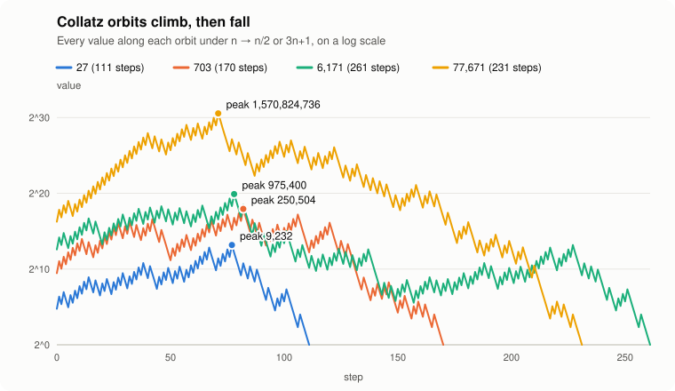
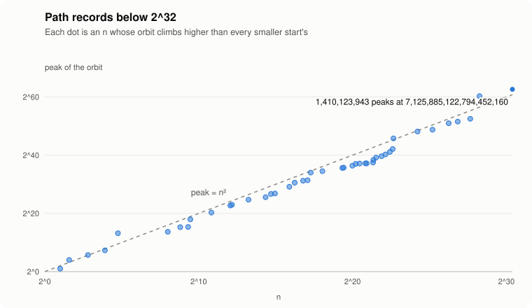
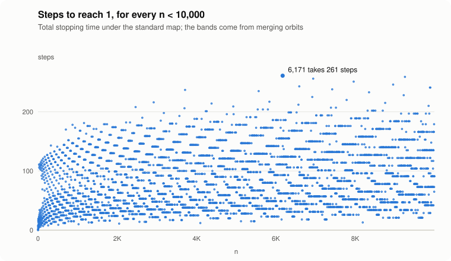

# collatz

**A fast, dependency-free verifier and explorer for the Collatz (3n+1) conjecture, in pure Rust.**

[](https://github.com/opsec-bot/collatz/actions/workflows/ci.yml)


Take any positive integer. If it is even, halve it; if it is odd, triple it and add one. Repeat.
The conjecture says you always reach 1. Nobody knows why, and nobody has found a counterexample.

<p align="center"></p>

This project checks the conjecture quickly and provably, and makes the data easy to look at:

- **Verifies all 1.1 trillion numbers below 2^40 in under 6 minutes** on 4 CPU cores
  (about 3 billion numbers per second), with a reproducible checksum.
- **Skips 99% of numbers with sieves that come with proofs**, not heuristics.
- **Reproduces the published records**: path records (77671 climbs to 1,570,824,736) and
  delay records (837799 takes 524 steps).
- **Handles numbers of any size** with its own arbitrary-precision integer, so `2^1000+1` works.
- **Finds every cycle** of `3n+1` and its relatives like `5n+1`, by brute force and by solving the cycle equation.
- **Measures something we couldn't find in the literature:** how often 3n−1 (3n+1 on the negative
  integers) ends in each of its three cycles. The answer appears to be 32.68% / 32.51% / 34.81%,
  stable from 2^20 up to 2^1000. [More below](#new-where-3n1-orbits-end).
- **Zero dependencies.** Threads, argument parsing, bignums, charts and SVG output are all written
  with the standard library only.

## Quick start

```sh
git clone https://github.com/opsec-bot/collatz
cd collatz
cargo build --release
./target/release/collatz help
```

Numbers can be written as expressions: `2^32`, `1e9`, `3*2^60+1`, `(2^64-1)^2`.

## What it can do

### Look at one orbit

```text
$ collatz orbit 27 --width 60 --height 8

  27  reaches 1 in 111 steps

  standard steps  111  (41 odd, 70 even)
  shortcut steps  70
  stopping time   59 shortcut steps to drop below the start
  peak            9,232  (2^13.17, 342x the start)
  parity          11011111010110111011110100111011  (first 32 shortcut steps, 1 = odd)

  log2 of every value under the standard map (112 values)

  2^13.2 ┤                                  ▁▃▆  ▂▅█▃
         ┤                   ▂▄ ▂   ▁  ▂  ▃▆███▅▇████▁▄ ▂
         ┤        ▃▁  ▂ ▃ ▆▄▇████▆▄▆█▄▇█ ██████████████▃██▃
         ┤  ▂ ▃▆█▄██▄▇███▆█████████████████████████████████▂▅  ▁▄
         ┤ ▇█████████████████████████████████████████████████▃▆██▇
         ┤▇███████████████████████████████████████████████████████▅▃
         ┤██████████████████████████████████████████████████████████▇
   2^0.0 ┤███████████████████████████████████████████████████████████▅
         └────────────────────────────────────────────────────────────
```

Any size works: `collatz orbit "2^1000+1"`. Add `--map shortcut` or `--map syracuse` to
change the map, and `--full` to print every value.

### Verify a range

```text
$ collatz verify 2^40

  Verifying every n < 2^40 (1,099,511,627,776) on 4 threads with a 2^24 sieve

  ✓ every n < 1,099,511,627,776 reaches 1

  orbits run   10,434,301,610  (99.05% skipped by the sieves)
  steps taken  423,607,797,890 shortcut steps
  slowest      898,696,369,947 needs 550 steps to drop below itself
  checksum     082b472d53fee860
  time         5m 53s  (3.11 billion numbers/s)
```

The checksum depends only on the limit and the sieve depth, never on the number of threads,
so two machines can confirm they did the same work.

### Find records

```text
$ collatz records 2^32          # path records: orbits that climb higher than all before
  ...
  44    319,804,831  1,414,236,446,719,942,480        2.134
  45  1,410,123,943  7,125,885,122,794,452,160        2.061

$ collatz delays 1e6            # delay records: starts that take longer than all before
  ...
  43  626,331    508         38.06
  44  837,799    524         38.42
```

Path records below 2^32 take under 2 seconds, and all 45 match the
[published table](https://pcbarina.fit.vutbr.cz/path-records.htm). (That table lists peaks under the
shortcut map, which are half the standard-map peaks shown here.) Their peaks grow like n², as
Lagarias and Weiss predicted:

<p align="center"></p>

### Hunt for cycles

A proof has to explain why 1 → 4 → 2 is the only positive cycle, so it helps to see what the
near misses do. On negative numbers `3n+1` has three more cycles; `5n+1` has extra cycles *and*
orbits that seem to grow forever:

```text
$ collatz cycles --a 5 --b 1 --positive --range 200

  cycle 1  length 7, 2 odd, reached from 33 starts
           1 → 6 → 3 → 16 → 8 → 4 → 2

  cycle 2  length 10, 3 odd, reached from 18 starts
           13 → 66 → 33 → 166 → 83 → 416 → 208 → 104 → 52 → 26

  cycle 3  length 10, 3 odd, reached from 10 starts
           17 → 86 → 43 → 216 → 108 → 54 → 27 → 136 → 68 → 34

  139 starts escaped past 2^100 or 100,000 steps without repeating, e.g. 7, 9, 11, 14, 18, ...
```

`collatz patterns 24` goes the other way: it solves the cycle equation for all 33 million parity
patterns up to length 24 and proves that the only integer cycles that short are 1 → 2 and the three
negative ones.

### New: where 3n−1 orbits end

Run on the negative integers, 3n+1 becomes 3n−1, which has three cycles instead of one: through 1,
5 and 17. In 2020, commenters on Terence Tao's blog wondered whether the 17-cycle "acts as a net"
that catches more numbers than the others. We couldn't find anyone who had measured it, so this
project did:

```text
$ collatz verify 2^40 --minus
  ✓ every n < 1,099,511,627,776 reaches one of the cycles through 1, 5 and 17

$ collatz basins 2^36 --table 2^32
```

| ends in | all n < 2^36 (exact) | random 1000-bit n (10⁷ samples) |
|---|---:|---:|
| 1 | 32.680% | 32.68 ± 0.03% |
| 5 → 7 → 10 | 32.508% | 32.50 ± 0.03% |
| 17 → 25 → … → 34 | **34.812%** | **34.82 ± 0.03%** |

<p align="center"></p>

The 17-cycle really does catch the most, and the shares agree to ±0.03% from 2^40 up to 1000-bit
numbers. That strongly suggests (but does not prove) that the three basins have natural densities.
The full write-up, with methods, caveats and open questions, is in
[`docs/3n-minus-1-basins.md`](docs/3n-minus-1-basins.md).

### Plot

`collatz plot orbits`, `collatz plot stopping` and `collatz plot records` write the SVG charts in
this README (they follow your light or dark theme):

<p align="center"></p>

## How the verifier works

To show every `n < N` reaches 1, check them in increasing order and show that each one
**drops below itself**. The smaller value it reaches has already been verified, so by
induction you are done. Then make that check as rare and as cheap as possible.

**1. Skip whole runs of steps.** The shortcut map is `T(n) = n/2` for even `n` and
`(3n+1)/2` for odd `n`. A run of `z` halvings is one trailing-zero count and one shift. A run of
`a` odd steps is a single multiplication: if `n + 1 = 2^a · m` with `m` odd, then
`T^a(n) = 3^a · m − 1`.

**2. The 2^k descent sieve.** The first `k` steps of `n` depend only on `n mod 2^k`. Writing
`n = r + a·2^k`, after `j ≤ k` steps

```text
T^j(n) = T^j(r) + 3^f · 2^(k−j) · a          (f = odd steps among the first j)
```

so `T^j(n) < n` is a linear inequality in `a`. When `3^f < 2^j` the left side grows more slowly,
and checking `a = 1` proves it for every `n ≥ 2^k` in the class. A residue class passing this test
at any `j ≤ k` never needs to be run. At `k = 24` only **1.7%** of classes survive. The sieve is
built one bit at a time from the previous level's survivors, and its counts match
[OEIS A076227](https://oeis.org/A076227).

**3. The mod 9 sieve.** If `n ≡ 2 (mod 3)`, then `(2n−1)/3` is smaller and steps straight to `n`.
If `n ≡ 4 (mod 9)`, then `(8n−5)/9` is smaller and reaches `n` in three steps. So
`n ≡ 2, 4, 5, 8 (mod 9)` is always covered by a smaller start, which removes 4 of every 9 survivors.

**4. Parallelism without dependencies.** The range is cut into `2^k` blocks handed to
`std::thread::scope` workers through an atomic counter. Each block's result goes into an
FNV-1a checksum in block order.

**5. Never overflow silently.** Values are `u128` with checked arithmetic. Anything that
overflows is re-run with the built-in `BigUint`, so orbits of numbers near 2^64, which peak past
2^128, stay exact.

Path-record search uses the same sieve, plus one more fact: the sieve also bounds how high a
skipped orbit can climb before it descends. A block is only skipped once the current record is
provably out of reach, and blocks where that check fails are rescanned in full.

### What each piece is worth

`collatz bench 2^30`, single-threaded unless noted, on a 4-core Intel Xeon cloud VM at 2.1 GHz:

| method | time | numbers/s | speedup |
|---|---:|---:|---:|
| naive loop, every n | 10.98 s | 98 million | 1.0x |
| naive loop, sieved | 1.98 s | 543 million | 5.6x |
| run-skipping engine, sieves | 1.29 s | 834 million | 8.5x |
| engine + sieves, 4 threads | 541 ms | 1.98 billion | 20.3x |

## Correctness

Fast code is worthless if it is wrong, so every shortcut is checked against the slow definition:

- The fast engine matches a one-step-at-a-time loop for every `n` below 20,000, both to the first
  descent and all the way to 1, and matches the exact `BigUint` engine for arbitrary targets.
- Every sieved residue really descends within `k` steps, and the growth bound holds.
- The verifier runs exactly the numbers the sieves leave over, and finds the known stopping-time
  records (626331 below a million).
- All 45 path records below 2^32 match the published table, and the sieved search matches a
  brute-force search for every sieve depth tried. Delay records match the known values.
- `BigUint` agrees with `u128` wherever both apply.
- The checksum is identical for 1, 2, 3 and 8 threads.
- End-to-end tests run the real binary for every subcommand.

```sh
cargo test --release                        # everything except the slowest check
cargo test --release -- --include-ignored   # also every path record below 2^32
```

## Layout

| module | contents |
|---|---|
| [`map`](src/map.rs) | the standard, shortcut and Syracuse maps with overflow checks |
| [`bigint`](src/bigint.rs) | a small arbitrary-precision unsigned integer |
| [`orbit`](src/orbit.rs) | the run-skipping engine, stopping times, peaks, parity vectors |
| [`sieve`](src/sieve.rs) | the 2^k descent sieve and the mod 9 sieve |
| [`verify`](src/verify.rs) | the parallel range verifier |
| [`records`](src/records.rs) | path records and delay records |
| [`cycles`](src/cycles.rs) | cycle detection for `an+b` maps and the cycle equation |
| [`basins`](src/basins.rs) | which 3n−1 cycle each number ends in: exact tables and sampling |
| [`plot`](src/plot.rs) | SVG charts |
| [`expr`](src/expr.rs) | the `2^40`-style number parser |
| [`cli`](src/cli) | the command-line tool |

## What this is not

This program cannot prove the conjecture, and neither can any other: checking finitely many
numbers says nothing about the rest. The current record is every `n < 2^71`, held by a distributed
GPU project. What a verifier *can* do is find a counterexample if one exists in its range, and raise
the lower bounds on the size of any cycle other than 1 → 4 → 2.

[`docs/research-notes.md`](docs/research-notes.md) summarizes the state of the art: what has been
proven, what a proof would need, and why the known approaches stall.

## License

[MIT](LICENSE)
