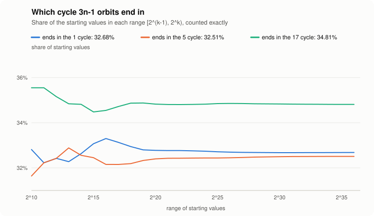

# Where 3n−1 orbits end

**Short version:** every n below 2^40 reaches one of the three known cycles of 3n−1, and the share of
numbers ending in each cycle appears to settle to a fixed value:

| cycle | share of all n below 2^36 (exact) | share of random 1000-bit n (10 million samples) |
|---|---:|---:|
| 1 | 32.680% | 32.68 ± 0.03% |
| 5 → 7 → 10 | 32.508% | 32.50 ± 0.03% |
| 17 → 25 → … → 34 (11 steps) | **34.812%** | **34.82 ± 0.03%** |

The 17-cycle is the largest basin, by about 2 percentage points. The 1-cycle and 5-cycle basins are
nearly the same size, about 0.17 points apart.

These are measurements, not theorems: nobody has proven that these densities exist.

## The question

The map n → n/2 (n even), n → 3n − 1 (n odd) is the Collatz map run on the negative integers
(substitute n → −n). Unlike 3n+1, it has three known cycles. Written with the shortcut map
T(n) = n/2 or (3n − 1)/2:

- **1** (a fixed point)
- **5 → 7 → 10**
- **17 → 25 → 37 → 55 → 82 → 41 → 61 → 91 → 136 → 68 → 34**

The 3n−1 conjecture says every positive integer ends in one of these. If it holds, the positive
integers split into three *basins*, and it is natural to ask how big each one is.

In comments on Terence Tao's
[January 2020 post](https://terrytao.wordpress.com/2020/01/25/equidistribution-of-syracuse-random-variables-and-density-of-collatz-preimages/)
on Collatz preimage densities, Tao pointed out the two extra cycles, and a commenter speculated that
"the '17' cycle acts as a catch or net of sorts" that attracts more numbers than the others. We could
not find any computed basin sizes in the literature, so we measured them. (Literature search done
October 2026; if you know of earlier work, please open an issue.)

## Results

### 1. Verification

```text
$ collatz verify 2^40 --minus
  ✓ every n < 1,099,511,627,776 reaches one of the cycles through 1, 5 and 17
  orbits run   10,434,301,626  (99.05% skipped by the sieves)
  slowest      1,085,552,373,249 needs 544 steps to drop below itself
  checksum     41271370545d54aa
  time         6m 29s
```

This uses the same proven sieves as the 3n+1 verifier, adapted to 3n−1 (see
[`src/sieve.rs`](../src/sieve.rs)). A number either drops below itself, so it inherits the basin of
a smaller, already-verified number, or it is 5 or 17, the minimum of its own cycle.

### 2. Exact basin shares below 2^36

Every one of the 68.7 billion numbers below 2^36 was assigned its basin exactly. Shares within each
range [2^(k−1), 2^k):

| range | → 1 | → 5 | → 17 |
|---|---:|---:|---:|
| [2^9, 2^10) | 32.812% | 31.641% | 35.547% |
| [2^15, 2^16) | 33.301% | 32.153% | 34.546% |
| [2^19, 2^20) | 32.776% | 32.400% | 34.824% |
| [2^23, 2^24) | 32.740% | 32.438% | 34.822% |
| [2^27, 2^28) | 32.683% | 32.477% | 34.839% |
| [2^31, 2^32) | 32.675% | 32.505% | 34.820% |
| [2^33, 2^34) | 32.678% | 32.508% | 34.814% |
| [2^35, 2^36) | 32.682% | 32.508% | 34.810% |
| **all n < 2^36** | **32.680%** | **32.508%** | **34.812%** |

<p align="center"></p>

Below about 2^20 the shares wander by a few tenths of a percent. From there on they drift by
thousandths of a percent per doubling.

### 3. Random samples at much larger scales

If the shares are true densities, numbers of a completely different size should give the same answer.
For each size we drew 10 million uniformly random n in [2^b, 2^(b+1)) and followed each orbit exactly
(with arbitrary-precision arithmetic past 128 bits) until it entered the lookup table:

| size | → 1 | → 5 | → 17 |
|---|---:|---:|---:|
| n ≈ 2^40 | 32.71 ± 0.03% | 32.50 ± 0.03% | 34.79 ± 0.03% |
| n ≈ 2^64 | 32.67 ± 0.03% | 32.50 ± 0.03% | 34.82 ± 0.03% |
| n ≈ 2^100 | 32.67 ± 0.03% | 32.53 ± 0.03% | 34.80 ± 0.03% |
| n ≈ 2^128 | 32.69 ± 0.03% | 32.50 ± 0.03% | 34.81 ± 0.03% |
| n ≈ 2^200 | 32.69 ± 0.03% | 32.50 ± 0.03% | 34.81 ± 0.03% |
| n ≈ 2^500 | 32.69 ± 0.03% | 32.50 ± 0.03% | 34.82 ± 0.03% |
| n ≈ 2^1000 | 32.68 ± 0.03% | 32.50 ± 0.03% | 34.82 ± 0.03% |

Intervals are 95% binomial intervals (seed 2026). Every row agrees with the exact shares within its
margin of error, across a factor of 2^960 in size.

## What this does and doesn't show

- **It strongly suggests the three basins have natural densities**, close to 32.68%, 32.51% and
  34.81%, and that the 17-cycle's basin really is the largest. It does not prove either.
- **A plausible explanation, also unproven:** heuristically, an orbit starting from a huge number
  behaves like a random walk that drifts downward and "forgets" where it started. When it finally
  enters the region of small numbers, where its basin is decided, it lands with a distribution that
  doesn't depend on the starting size. The agreement from 2^40 to 2^1000 is what that picture predicts.
- **The shares are not proportional to cycle length.** The 17-cycle is 11 shortcut steps long and the
  5-cycle is 3, yet their basins differ by only 7%. Whatever sets the shares is more subtle.
- **Caveats.** The samples are pseudorandom (SplitMix64), and the intervals assume independent draws.
  Exact counts stop at 2^36, so very slow drifts beyond that would show up only in the sampled rows,
  which agree. And everything assumes the 3n−1 conjecture, which is checked only up to 2^40 here.

## Open questions

1. Prove that the basins of 3n−1 have natural densities, even without computing them.
2. Find a formula or a fast-converging method that predicts 32.68 / 32.51 / 34.81 from first
   principles, for example from a Markov model of orbits entering the small numbers.
3. Do the same for other maps with several cycles, such as 5n+1, where some orbits seem to diverge,
   and 3n+d for other d.

## Reproducing

```sh
cargo build --release
./target/release/collatz verify 2^40 --minus                                   # ~6.5 min
./target/release/collatz basins 2^36 --table 2^32 --samples 0 -o basins.svg    # ~19 min, 4 GB RAM
./target/release/collatz basins 2^20 --table 2^30 --samples 1e7 --seed 2026 \
    --bits 40,64,100,128,200,500,1000                                          # ~5 min
```

Times are on a 4-core 2.1 GHz Intel Xeon cloud VM. The exact counts are deterministic, and the samples
depend only on the seed, not on the thread count.

**How the code is checked:**
- The basin lookup table matches a naive step-by-step orbit for every n below 300,000.
- Exact counts past the table match a larger table.
- The fast 3n−1 engine matches a naive loop for every n below 20,000, and the exact big-integer
  engine past 2^128.
- The 3n−1 sieves are checked against direct computation.
- Sampling gives identical results on 1 and 4 threads.

See [`src/basins.rs`](../src/basins.rs).
